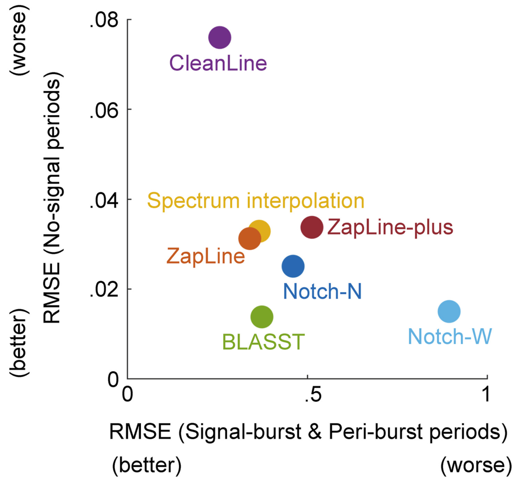
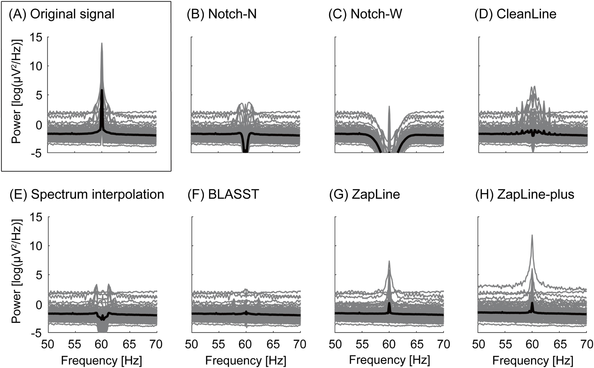
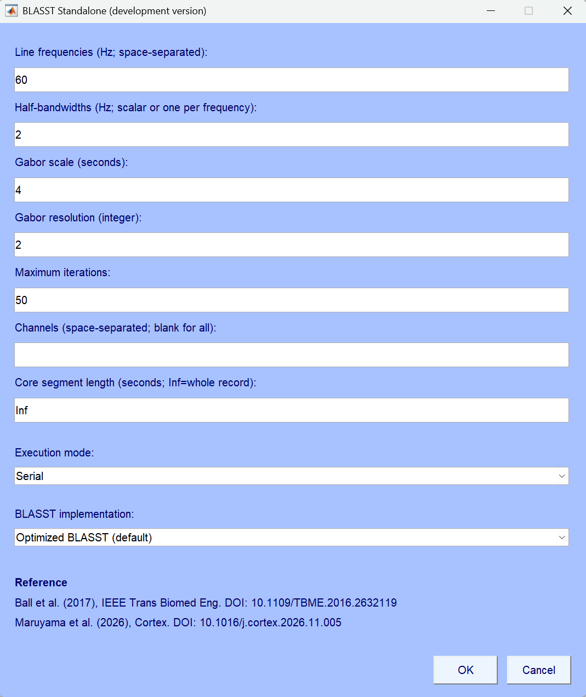

# BLASST — Standalone and Optimized EEGLAB Plugin

**Band-Limited Atomic Sampling with Spectral Tuning (BLASST)**  
**EEGLAB plugin v1.0.0** | MATLAB | [Apache-2.0 license](LICENSE)

BLASST (Ball et al., 2017) is a frequency-selective, time-adaptive approach to removing nonstationary power-line interference from EEG. This standalone [EEGLAB](https://sccn.ucsd.edu/eeglab/) plugin provides both a **PREP-derived legacy implementation** and a separately maintained **performance-optimized implementation**. Users can switch between them without silently replacing the earlier implementation. **Optimized is the default; Serial is the default execution mode.**

[**Download BLASST Standalone v1.0.0**](BLASST_Standalone_v1.0.0.zip) · [Original method](https://doi.org/10.1109/TBME.2016.2632119) · [Independent algorithm comparison](https://doi.org/10.1016/j.cortex.2026.11.005)

## 1. How BLASST works

BLASST was introduced by **Ball, Hairston, Franaszczuk, and Robbins** in *IEEE Transactions on Biomedical Engineering* (**2017**, published online in **2016**). Unlike a fixed notch filter, which suppresses an entire frequency band regardless of whether the energy represents line noise or neural activity, BLASST models interference as a collection of **time-localized Gabor atoms** and removes their fitted contribution.

The method is inspired by *matching pursuit* but restricts the dictionary to a target line-frequency band and predetermined time locations. Within this restricted dictionary it:

1. **Finds the best-fitting Gabor components** around a specified line frequency (e.g., 50 or 60 Hz), accommodating changes in interference amplitude, phase, and frequency over time.
2. **Spectrally tunes the fitted amplitudes.** Gabor coefficients in neighboring, off-target frequency bands estimate the background signal power. This penalizes fitted atoms that could otherwise remove genuine short-lived broadband events along with the interference.
3. **Stops adaptively.** BLASST compares the distributions of log-power Gabor coefficients in the target and surrounding bands using the **Bhattacharyya distance** and stops when further subtraction no longer improves the distributional match.

This combination is particularly relevant when line noise overlaps the gamma band or is nonstationary. It does not imply that the algorithm can infallibly distinguish neuronal oscillations from interference at the *same* frequency; all denoising methods require assumptions about the signal and the noise.

**Original publication:** Ball, K. R., Hairston, W. D., Franaszczuk, P. J., & Robbins, K. A. (2017). *BLASST: Band Limited Atomic Sampling With Spectral Tuning With Applications to Utility Line Noise Filtering.* IEEE Transactions on Biomedical Engineering, **64**(9), 2276–2287. [doi:10.1109/TBME.2016.2632119](https://doi.org/10.1109/TBME.2016.2632119); PMID: [27893379](https://pubmed.ncbi.nlm.nih.gov/27893379/).

## 2. How does BLASST compare with other line-noise removal methods?

In a recent systematic comparison, **Maruyama et al. (2026)** evaluated **seven approaches**: narrow- and wide-band notch filtering, spectrum interpolation, CleanLine, BLASST, ZapLine, and ZapLine-plus. Simulated EEG containing transient neuronal bursts and nonstationary line noise was used to assess **signal preservation**, **peri-burst distortion**, and **residual noise** separately; empirical resting-state EEG from **99 participants** was also analyzed.



*Performance trade-off in the evaluated simulation (excerpt from Fig. 4D of Maruyama et al., 2026). Lower RMSE is better on both axes. BLASST occupies a favorable region, with particularly low residual error during no-signal periods while avoiding the much larger signal-region errors of aggressive wide-band notch filtering. CleanLine better preserved the simulated narrowband burst itself, but left substantially greater residual error in no-signal periods. Thus, no single method dominated both objectives.*



*Illustrative 60-Hz spectral results for the same seven algorithms (excerpt from Fig. 3 of Maruyama et al., 2026). BLASST strongly reduces line-frequency contamination without the wide spectral attenuation associated with a broad notch. Gray traces show individual channels; black traces show the summary spectrum displayed in the source figure.*

**Key result:** In the evaluated **99-participant resting-state EEG dataset**, BLASST produced the **flattest PSD around line noise and the smallest median error at 10-second temporal resolution**; ZapLine and ZapLine-plus were close competitors. In the simulation, BLASST gave particularly strong noise rejection, while CleanLine better preserved the short narrowband signal burst. These findings make BLASST **one of the strongest currently benchmarked options for line-noise rejection**, especially when minimizing residual contamination is paramount. **They do not establish a universally best algorithm for every EEG dataset or scientific objective.**

**Comparison publication:** Maruyama, Y., et al. (2026). *Comparing line-noise removal algorithms for EEG data processing.* **Cortex**, published online November 7, 2026. [doi:10.1016/j.cortex.2026.11.005](https://doi.org/10.1016/j.cortex.2026.11.005).

*Figure source and reuse:* The above excerpts were supplied by an author of Maruyama et al. (2026). The source paper should be cited whenever these images are reused; verify the publisher's applicable figure-reuse terms before redistributing the images publicly.

## 3. Two implementations, one interface

| Selectable implementation | Description |
| --- | --- |
| **Optimized BLASST** (**default**) | Separate implementation containing FFT-length optimization, selected-atom construction, filter-FFT caching, and faster compatible histogram counting. |
| **Original / Legacy BLASST** | **PREP-derived adapted port** retained from the standalone plugin's earlier implementation, to support historical comparison and reproducibility. |

**Provenance matters:** The GUI's **Original** option denotes the plugin's **PREP-derived legacy port**, *not* a byte-for-byte copy of the separately published `blasstOriginal*.m` files. The corresponding public source families are [PREP / EEG-Clean-Tools](https://github.com/VisLab/EEG-Clean-Tools/tree/0914132081ea7d534ee19f96973791fd81825755/PrepPipeline/utilities/blasst) and [VisLab/blasst](https://github.com/VisLab/blasst/tree/bc0785c635c0baa68efafa9ca5cdf7ca23965b12/blasst). The legacy code and optimized code remain in separate MATLAB namespaces; the original authors' attributions and license notices are retained.

### 3.1 What was optimized?

The performance work was carried out by **Makoto Miyakoshi** (a coauthor of Maruyama et al., 2026) with programming and benchmarking assistance from **OpenAI GPT-6 through ChatGPT Work**. The optimization changes *how* the original computations are performed, not their intended signal-processing model, parameter definitions, or stopping rule.

| Optimization | Mechanism | Measured incremental effect |
| --- | --- | --- |
| **FFT length (7-smooth padding)** | Pad linear convolutions to an FFT length factorable by 2, 3, 5, or 7 rather than accepting computationally unfavorable lengths. | **98.64 → 63.45 s**, **35.7% less time**, 300 s × 33 channels. |
| **A — Selected-atom construction** | Select the best Gabor frequency using the magnitude of complex inner products; construct only selected real Gabor atoms rather than a large 3D array of all candidates. | **63.45 → 38.26 s**, **39.7% less time**, 300 s × 33 channels. |
| **C — Filter-FFT cache** | Reuse FFTs of identical filter banks at identical padded FFT lengths, with bounded per-process memory. | **40.36 → 31.58 s** (**21.7%**) and **39.44 → 31.07 s** (**21.2%**) in paired 300 s × 33-channel runs. |
| **H — Compatible histogram counting** | Replace costly columnwise `hist` calls with `histcounts` while reproducing the original bin centers and edge semantics. | **31.45 → 27.29 s** (**13.2%**) and **31.22 → 27.48 s** (**12.0%**) in paired 300 s × 33-channel runs. |

The A change also avoided approximately **1.57 GiB of explicit 3D-atom allocation per atomic pass** for a 30-minute channel under the benchmark settings; this is a theoretical array-size reduction, **not** a measured decrease in total MATLAB process memory. Cache C can *increase* retained memory (bounded at **768 MiB per MATLAB process**) in exchange for less repeated FFT work. Other ideas—including concatenating target/reference filter banks and caching the small Gabor dictionary—were investigated but rejected when they did not improve overall processing time consistently.

### 3.2 Total measured processing time

| 33 channels of 50-Hz EEG | PREP-derived adapted baseline | Optimized Serial | Optimized Parallel (8 workers × 2 threads) |
| --- | ---: | ---: | ---: |
| **5 minutes/channel** | **98.6 s** | **27.4 s (3.6× faster)** | **18.4 s (5.4× faster)** |
| **30 minutes/channel** | **714.8 s** | **167.9 s (4.3× faster)** | **124.2 s (5.8× faster)** |

All times in the table represent **core processing only**; parallel pool startup was **excluded and measured separately**. The 30-minute parallel pool required **14.6 s** to start; startup-inclusive elapsed time would be approximately **138.8 s** for that run. These timings do not include complete EEGLAB import, GUI, or save times. Five-minute baseline/serial figures reflect separate matched benchmark campaigns; the cited incremental savings for C and H come from paired measurements. Hardware: Windows 11, Intel Core i9-10900K (10 physical cores), 96 GB RAM, MATLAB R2024b Update 3, EEGLAB 2024.0; benchmarked 33 channels at 256 Hz, 50 ± 2 Hz, 4-s Gabor scale, resolution 2, 50-iteration maximum. Speedups will depend on the data, hardware, MATLAB version, and parallel configuration.

### 3.3 How close are the outputs?

**Do not confuse numerical equivalence with bitwise identity across all implementations.** The full 30-minute × 33-channel optimized **Serial** output was **bitwise identical** to the intermediate accepted implementation A after incorporating optimizations C and H; thus C and H introduced **no further waveform difference** in that test. A versus the adapted legacy baseline was *not* bitwise identical, in part because changing FFT padding changes floating-point rounding: the largest relative L2 errors were **9.978 × 10⁻¹⁷** (cleaned waveform) and **7.316 × 10⁻¹⁶** (removed component). Accepted iteration counts matched **for all 33 channels**. Optimized Parallel versus optimized Serial had a maximum removed-component relative L2 error of **2.91 × 10⁻¹⁶**, again with identical accepted iteration counts.

A separate boundary-rich **~63-minute, one-channel** test conducted through EEGLAB took **42.0 s (Original)** versus **11.9 s (Optimized)** (**3.53× faster**), with 10 accepted iterations for both. After storage as EEGLAB `single` data, the two outputs matched **exactly** (`sum(abs(EEG_optimized.data - EEG_original.data)) == 0`). This particular `single`-precision agreement must not be generalized to bitwise equality of all internal double-precision results, arbitrary input signals, or all MATLAB releases.

## 4. Installation and use

1. Download [`BLASST_Standalone_v1.0.0.zip`](BLASST_Standalone_v1.0.0.zip), unpack it, and place the contained **`BLASST_Standalone_1.0.0`** directory in your EEGLAB `plugins` folder.
2. Ensure no older BLASST Standalone plugin directory remains on the active EEGLAB path, then restart EEGLAB.
3. Open **Tools → BLASST**. Select **Optimized** (default) or **Original** and adjust line frequencies, half-bandwidth, Gabor scale, resolution, iteration limit, and channels. The execution mode defaults to **Serial**; optional **Parallel** processing requires MATLAB Parallel Computing Toolbox.

<!-- Upload the final v1.0.0 settings-dialog screenshot as assets/blasst_gui_v1.0.0.png. -->


### MATLAB command-line example

```matlab
[EEG, com, report] = pop_blasst_standalone(EEG, ...
    'Implementation', 'optimized', ...
    'LineFrequencies', 50, ...
    'HalfBandwidths', 2, ...
    'ScaleSeconds', 4, ...
    'Resolution', 2, ...
    'MaxIterations', 50, ...
    'ExecutionMode', 'serial');
```

Set `'Implementation', 'legacy'` to use the PREP-derived legacy option. The plugin respects EEGLAB `boundary` events by processing continuous intervals independently; intervals too short for the selected Gabor scale are left unchanged and reported. It provides a progress window and estimated remaining time for both implementations. Segmented processing, if explicitly selected, should not be assumed equivalent to full-interval fitting.

### Reproducibility

The plugin stores the implementation label in `EEG.etc.BLASST.version` (`'Optimized'` or `'Original'`) and the release number in `EEG.etc.BLASST.pluginVersion` (`'1.0.0'`). It also records input and effective parameters, boundary cuts, and replay arguments under `EEG.etc.BLASST`; EEGLAB history commands are compatible with `eegh()`. **Replaying a cleaning operation requires the original unprocessed EEG** as input.

## 5. Limitations and responsible use

**Research software; use at your own risk.** The software is distributed **AS IS**, without warranty, under the [Apache License 2.0](LICENSE). Figures excerpted from *Cortex* may be subject to separate publisher permissions and are not automatically relicensed as Apache-2.0 content. Outputs should be inspected before being used in scientific or clinical interpretation.

The optimization benchmarks were conducted on **one workstation**, primarily using **one EEG dataset**, **one line frequency**, and **one MATLAB release**. Very close atom-score ties, other MATLAB releases (particularly histogram edge cases), unusual discontinuities, short recordings, and other parameter combinations may require additional validation. The legacy option is an *adapted PREP-derived port*, not the author's exact historical source. Neither this README nor the benchmark establishes that BLASST is the optimal cleaning method for every kind of EEG signal.

## 6. Authorship, provenance, and citation

**Original BLASST method:** Kenneth R. Ball, W. David Hairston, Piotr J. Franaszczuk, and Kay A. Robbins. Original MATLAB code by Kenneth Ball (2015), Apache-2.0 license. See the [authors' BLASST repository](https://github.com/VisLab/blasst) and the [PREP implementation](https://github.com/VisLab/EEG-Clean-Tools/tree/0914132081ea7d534ee19f96973791fd81825755/PrepPipeline/utilities/blasst).

**Standalone integration and performance optimization:** Makoto Miyakoshi, assisted by OpenAI GPT-6 / ChatGPT Work. The original method and the optimized *implementation* are intentionally identified separately; neither should be misrepresented as a different scientific invention. See the attribution and provenance files inside the distribution ZIP.

Please cite these papers as appropriate:

- **Algorithm:** Ball KR, Hairston WD, Franaszczuk PJ, Robbins KA. (2017). *BLASST: Band Limited Atomic Sampling With Spectral Tuning With Applications to Utility Line Noise Filtering.* **IEEE Transactions on Biomedical Engineering, 64**(9), 2276–2287. https://doi.org/10.1109/TBME.2016.2632119
- **Comparative evaluation:** Yasuhisa Maruyama, Natsue Yoshimura, Ernest V. Pedapati, Craig A. Erickson, Kenneth R. Ball, Kay A. Robbins, and Makoto Miyakoshi (2026). *Comparing line-noise removal algorithms for EEG data processing.* **Cortex** (online November 7, 2026). https://doi.org/10.1016/j.cortex.2026.11.005

---

*This README describes BLASST Standalone v1.0.0. Numerical-equivalence and speedup claims refer to the stated benchmark conditions; they are not blanket guarantees for untested data or platforms.*
